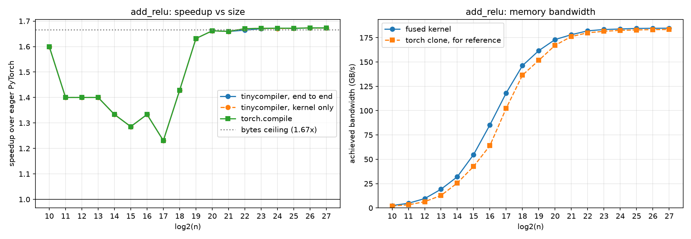
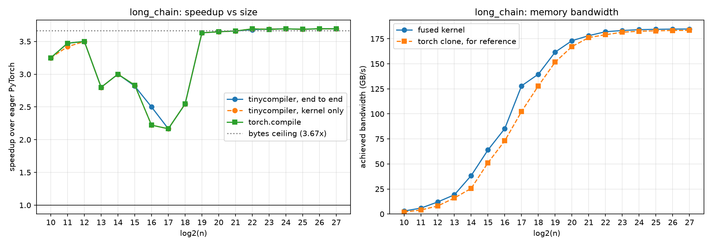
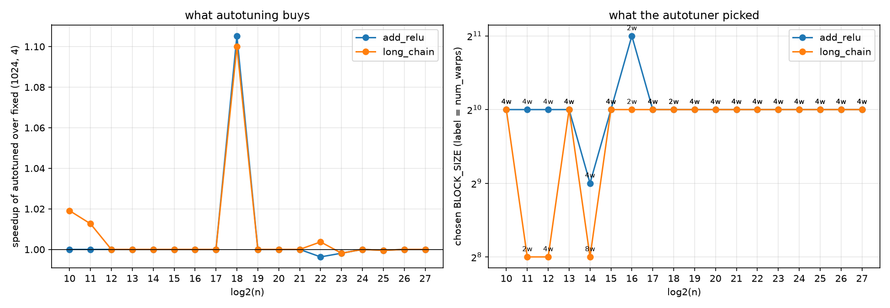
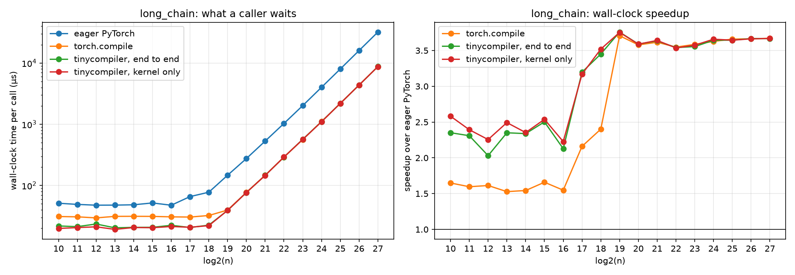

# tinycompiler

A small neural network compiler written in Python. It captures a PyTorch model as a graph, rewrites that graph to remove dead code and fuse elementwise operations, generates Triton GPU kernels for the fused groups, and autotunes their launch parameters.

## Why fusion helps

Most elementwise GPU work is limited by memory bandwidth, not arithmetic. Consider

```python
y = torch.relu(x + c)
```

on `n` float32 values. Eager PyTorch runs two kernels. The add reads `x` and `c` and writes an intermediate `t` (12n bytes), then the relu reads `t` and writes `y` (8n bytes), for 20n bytes in total. A fused kernel reads `x` and `c` once and writes `y` once, which is 12n bytes. The intermediate lives only in registers and never touches VRAM. That seemingly provides us a theoretical ceiling of 20n / 12n which is about 1.67× for large inputs, and the compiler's job is to reach it automatically.

## Pipeline

| Stage | File | What it does |
|---|---|---|
| Capture | `tinycompiler/capture.py` | Traces a model with `torch.fx` (symbolic trace, i.e it runs the classic 'forward' method with Proxies) and translates it into the compiler's own graph IR (`graph.py`) |
| Dead code elimination | `tinycompiler/passes/dce.py` | Repeatedly removes nodes whose results are never used, keeping model inputs and the output |
| Elementwise fusion | `tinycompiler/passes/fusion.py` | Merges chains of elementwise ops into one `fused` node whenever every consumer of an intermediate ends up in the same group |
| Code generation | `tinycompiler/codegen/triton_gen.py` | Writes Triton source for each fused node (one load per input, one line per op, one store), then compiles and caches it |
| Autotuning | `tinycompiler/codegen/autotune.py` | Times 15 block-size and warp-count configurations per kernel and size bucket, keeping the default unless another wins by at least 3% |
| Execution | `tinycompiler/interpreter.py` | Runs a graph either as reference PyTorch (op by op) or with generated Triton kernels for fused nodes |

For example, `sigmoid(relu(x + c) * 2 - 1)` becomes this single generated kernel.

```python
@triton.jit
def kernel(in0_ptr, in1_ptr, out_ptr, n, BLOCK_SIZE: tl.constexpr):
    pid = tl.program_id(0)
    offsets = pid * BLOCK_SIZE + tl.arange(0, BLOCK_SIZE)
    mask = offsets < n
    v0 = tl.load(in0_ptr + offsets, mask=mask)
    v1 = tl.load(in1_ptr + offsets, mask=mask)
    v2 = v0 + v1  # add
    v3 = tl.maximum(v2, 0.0)  # relu
    v4 = v3 * 2  # mul
    v5 = v4 - 1  # sub
    v6 = tl.sigmoid(v5)  # sigmoid
    tl.store(out_ptr + offsets, v6, mask=mask)
```

## Results

All measurements are on an RTX 3050 Laptop GPU (4 GB GDDR6, 75 W) under WSL2, sweeping input sizes from 2¹⁰ to 2²⁷ elements. 2²⁷ is the largest power of two at which the unfused version still fits in VRAM.

| Model | Speedup over eager at 2²⁷ | Bytes-moved ceiling | torch.compile |
|---|---|---|---|
| `relu(x + c)` | 1.67× | 1.67× | 1.67× |
| `sigmoid(relu(x + c) * 2 - 1)` | 3.69× | 3.67× | 3.69× |

The generated kernels sustain **185 GB/s**, about 96% of the GPU's 192 GB/s peak, and match `torch.compile` at large sizes, since both produce a single fused Triton kernel for these chains.




A few things the plots show.

**Mid-size dip.** Between 2¹⁴ and 2¹⁷, the speedup drops to around 1.2× for `relu(x + c)`. At those sizes the intermediate `t` fits in the 2 MB L2 cache, so eager PyTorch reads it back cheaply. The speedup returns to the ceiling at 2¹⁹, exactly where `t` reaches the size of L2.

**Bandwidth ramp.** Bandwidth only levels off around 2²¹, once every SM has enough blocks queued to hide memory latency.

**Autotuning.** The search space is flat for these bandwidth-bound kernels, staying within 1% at large inputs. The one consistent gain is about 11% at 2¹⁸, where 2 warps per block lets all 16 blocks per SM run in one wave instead of leaving a partial second wave.



**Wall-clock overhead.** The plots above use GPU time. Measured end to end, small inputs are dominated by launch overhead. Under WSL2 that's roughly 10 µs per eager PyTorch op and 20 µs per Triton launch through its Python launcher, while the graph interpreter itself adds only about 3 µs. So a one-launch fused kernel ties eager on two ops but wins by about 2.3× on five.



Large-input results are stable to within 0.1% between runs. Results for very small inputs vary by up to about 25%, because those kernels take only a few microseconds, close to the GPU timer's resolution.

## Usage

```bash
pip install -e .
pytest -q
```

```python
import torch
import torch.nn as nn

from tinycompiler.capture import capture
from tinycompiler.interpreter import run
from tinycompiler.passes.dce import eliminate_dead_code
from tinycompiler.passes.fusion import fuse_elementwise


class AddRelu(nn.Module):
    def forward(self, x, c):
        return torch.relu(x + c)


model = AddRelu().cuda()
graph = eliminate_dead_code(fuse_elementwise(capture(model)))

x = torch.randn(2**20, device="cuda")
c = torch.randn(2**20, device="cuda")
y = run(graph, model, x, c, use_triton=True, autotune=True)
```

To reproduce the benchmarks, which write CSVs and plots to `benchmarks/results/`, run these from the project root.

```bash
python3 benchmarks/bench_fusion.py
python3 benchmarks/bench_latency.py
python3 benchmarks/bench_autotune.py
```

## Testing

There are 51 tests. Every pass is checked numerically by running the graph before and after it and comparing against the original PyTorch model. Every generated kernel is checked against the reference interpreter, and across all fifteen autotuner configurations and at sizes that are not a multiple of the block size, so that masking is exercised. Unsupported inputs raise `NotImplementedError`.

## Limitations

Only elementwise operations are fused. Matmuls and linear layers run through PyTorch. All inputs to a fused kernel must share the same shape and dtype, so broadcasting is not supported yet, and only float32 has been tested. Keyword arguments, models returning more than one value, and method-style calls such as `x.relu()` are rejected with an error.

## Roadmap

**Generated wrapper (coming soon).** The interpreter currently walks the whole graph and checks each node's op on every call, costing about 3 µs per call. `torch.compile` instead generates a straight-line Python wrapper that launches each kernel in order with nothing to check at run time. Generating one here will remove that overhead.

**Hand-written CUDA baseline.** A raw CUDA kernel for the same fused operations, to compare against the generated Triton code.

**Transformer block (in progress).** This needs broadcasting (for bias vectors), GELU, and keyword-argument support. Elementwise fusion is expected to help much less here, since matmuls dominate the run time. Measuring that gap against `torch.compile`, which also fuses reductions such as LayerNorm and softmax, is part of the goal.

**CUDA graphs.** Recording a sequence of launches once and replaying it with a single call, to cut the small-input launch overhead.

## How this was built

The graph IR, dead code elimination, fusion, the interpreter were all written by me. Code generation, but especially the autotuner, required the assistance of an LLM. The tests and benchmark scripts were generated with AI assistance on purpose, so I could spend my time on the compiler. Every result here was run and checked on my own hardware.

## Environment

Python 3.12.3, PyTorch 2.15.0 (CUDA 13.2 build), Triton 3.9.0, NVIDIA driver 610.59 (CUDA 13.3), Ubuntu 24.04 under WSL2.
